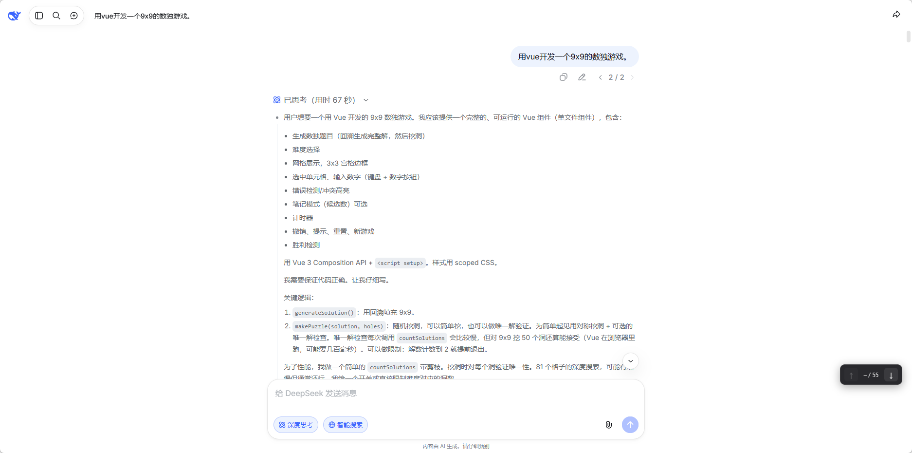

# DeepSeek 代码块导航

在 DeepSeek 网页对话中一键跳转到上一段 / 下一段代码块，免去反复滚动鼠标滚轮。

> 非官方扩展，与 DeepSeek 官方无关。

## 特性

- **复制按钮作为锚点**：以代码块右上角的「复制」按钮识别和排序代码块，天然排除用户输入、思考区等噪声
- **边界自动置灰**：处于第一个代码块时「上一段」不可点，处于最后一个代码块时「下一段」不可点
- **位置指示**：显示当前处于第几个代码块（如 `3 / 12`）
- **平滑滚动 + 高亮**：目标代码块滚动到视口上方 25% 处，并做 1.5 秒蓝色高亮
- **可拖拽浮动条**：位置自由调整，不遮挡正文
- **零数据收集**：所有逻辑在浏览器本地执行

## 截图



## 安装（开发者模式）

1. 下载本仓库源码
2. 打开 `chrome://extensions/`（Edge 为 `edge://extensions/`），开启「开发者模式」
3. 点击「加载已解压的扩展程序」，选择 `src/` 目录
4. 打开 <https://chat.deepseek.com/> 并进入含代码块的对话

## 使用

页面右下角出现浮动导航条 `[↑] 3 / 12 [↓]`：

| 操作 | 效果 |
| --- | --- |
| 点击 ↑ | 跳转到上一段代码块 |
| 点击 ↓ | 跳转到下一段代码块 |
| 拖动空白处 | 移动导航条位置 |

## 开发

```bash
python scripts/generate-icons.py   # 生成图标

# linux打包脚本
./scripts/pack.sh                  # 打包到 dist/

# windows打包命令，powershell中执行
New-Item -ItemType Directory -Force -Path dist | Out-Null
Compress-Archive -Path src\manifest.json, src\content.js, src\icon-16.png, src\icon-32.png, src\icon-48.png, src\icon-128.png -DestinationPath dist\deepseek-code-nav.zip -Force
```

改动 `src/content.js` 后，在扩展管理页点击「重新加载」，刷新对话页面即可生效。

## 已知限制

- DeepSeek 页面结构改版可能导致复制按钮识别失败，此时自动退化为 `pre` 兜底
- 流式生成期间点击跳转，页面若强制钉底，可能出现一次视觉回弹

## 隐私

本扩展不收集、存储或传输任何用户数据，详见 [PRIVACY.md](PRIVACY.md)。

## 许可

[MIT](LICENSE)